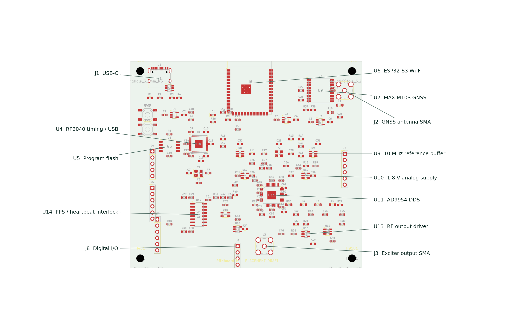

# PRNboard

A standalone GNSS-timed PRN ionosonde exciter, intended to replace the transmit USRP and `tx_uhd.py` in [ionosonde](https://github.com/jvierine/ionosonde).

- **0.5–30 MHz**, uploaded binary phase code, **10–1000 µs chips** (default **30 µs**).
- **Continuous phase-continuous LFM**, typically **100 or 500 kHz/s**, using the AD9954 hardware ramp engine.
- Up to **1000 frequencies in user-defined order**, timed sweeps or single-frequency operation.
- GNSS PPS and disciplined **10 MHz TCXO**. **No qualified timing/frequency lock → no transmission.**
- **Wi-Fi and USB** configuration; stored programs run without a computer or internet.
- SMA exciter output; optional **separate protected, cooled 10 W PA**, with harmonic filtering and final 50 MHz LPF.
- Future telemetry and seven independently coded exciter outputs.

**Target: $50–100 per assembled exciter board**, using common parts with sustainable sourcing. Antenna, enclosure, adapter, cables, tax, freight, engineering, and PA are excluded. Revision B components total about **$77**, using a conservative $45 DDS allowance. Allow roughly **$95–115 assembled** in small batches; this is an estimate, not a fabrication quote.

**Current draft:** RP2040 timing/USB controller, ESP32-S3 Wi-Fi, AD9954 DDS (200 MHz, internal ×20 PLL), and stocked MAX-M10S GNSS. PRN and LFM register-level reference simulations pass; physical hardware remains untested. Any suitable dual-frequency raw-data receiver may replace the single-frequency fallback when availability and cost allow; TEC is optional.

**Status:** editable KiCad circuit and **unrouted placement study**, plus a tested host program compiler and end-to-end reference simulation. **Not ready to order.** Routing, firmware, sourcing and RF/timing validation remain. No fabrication order has been placed.

Current 95 × 85 mm placement draft, top view. Copper routing is unfinished; the 10 W PA is separate.

[End-to-end simulation and results](docs/end-to-end.md) · [Revision B and remaining work](docs/revision-b.md) · [LFM results](docs/lfm.md) · [Sourcing](docs/sourcing.md) · [Requirements](docs/requirements.md)

Open `hardware/prnboard.kicad_pro` in KiCad 10.
