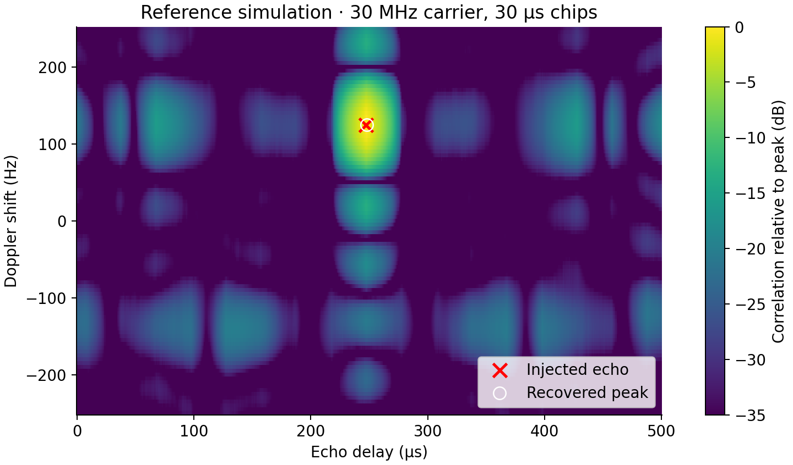
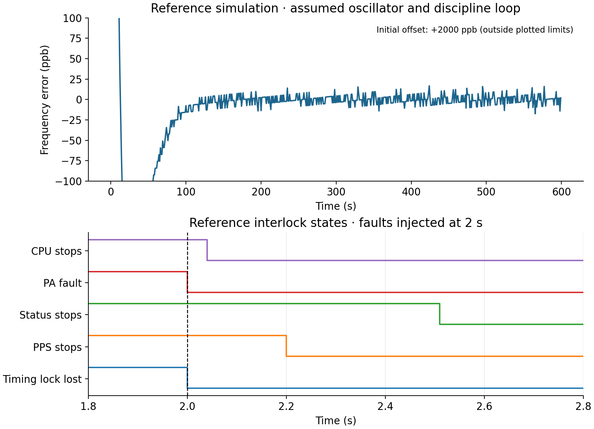

# End-to-end reference test

**Result: PASS in simulation. This does not test board hardware or MCU firmware.**

The test compiles an explicit binary code and frequency program to HDF5, closes the file, reloads it through a separate validator, schedules the saved table, emits 40-bit AD9850 serial frames, decodes those frames with a separate shift-register model, synthesizes a clocked 10-bit DAC waveform, and applies the nominal LC filter from the current circuit manifest. A delayed, Doppler-shifted, noisy echo is then downconverted and acquired using an independent receiver reference constructed from the original requested code, not the transmitted samples. No true echo delay or Doppler is provided to the receiver search.



## Acquisition results

Every RF case injects a **247 µs delay and +125 Hz Doppler**, with **−10 dB SNR per real RF sample**. The receiver samples complex baseband at 1 MHz and searches 0–500 µs delay and −250 to +250 Hz Doppler in 5 Hz steps. Acceptance is delay error ≤2 µs, Doppler error ≤5 Hz, and normalized correlation >0.65.

| Carrier (MHz) | Chip (µs) | Recovered delay (µs) | Recovered Doppler (Hz) | Correlation |
| --- | --- | --- | --- | --- |
| 30 | 30 | 248 | 125 | 0.912 |
| 0.5 | 30 | 248 | 125 | 0.914 |
| 10 | 30 | 248 | 125 | 0.913 |
| 30 | 10 | 248 | 125 | 0.904 |
| 0.5 | 10 | 248 | 125 | 0.906 |
| 10 | 10 | 248 | 125 | 0.901 |
| 30 | 1000 | 248 | 125 | 0.916 |
| 0.5 | 1000 | 248 | 125 | 0.916 |
| 10 | 1000 | 248 | 125 | 0.916 |

The recovered-delay offset includes finite sample-grid and modeled signal-path effects; this test does not establish sub-microsecond absolute ranging accuracy. A 1 µs search grid is not a 1 µs waveform range resolution: these are isolated-echo estimation tests, not tests of resolving nearby echoes. The long-chip case uses a shorter 31-chip test sequence; other RF cases use 127 chips or its 31-chip prefix. These are synthetic demonstration codes, not agreed station codes.

The RF simulation runs at 100 MS/s for bounded 16–124 ms records. It does **not** simulate every RF sample of the full five-minute interval. A separate event-level schedule test checks the requested nonascending order (30, 0.5, 10 MHz), 2 s dwell, 100 µs end-of-dwell mute guards, 300 s recurrence, and restart at the next complete sweep after reacquisition. Integration tests also exercise 1000 table entries with a sufficiently long repeat interval, one-shot mode, and single-frequency mode. The absolute UTC/PPS association and leap-second handling are not implemented firmware and are not validated here.

## Existing ionosonde decoder

The same saved synthetic IQ was also decoded by the existing ionosonde `analyze_prc2` algorithm, using a pinned source snapshot and unchanged function bodies. All three carrier cases passed: the decoder recovered the 248 µs range bin. Its four-code-period FFT has 65.62 Hz Doppler bins and a 262.47 Hz periodic span; the reported −131.23 Hz bin is 6.23 Hz from the injected +125 Hz after circular wrapping, within half a bin. This short-record check does not establish high Doppler resolution or remove the code-period sampling ambiguity. Upstream source identity and hash are recorded in the machine-readable result.

## Fault and negative tests

The reference gate starts inhibited without PPS/status. Tests inject timing-lock loss, missing PPS, missing GNSS status, PA fault, and a frozen CPU while the qualified output remains latched. Software health checks run on a 10 ms model grid, with a 1.2 s PPS freshness limit, 1.5 s status freshness limit, 50 ms external heartbeat timeout, and 2.2 s external PPS timeout. These values are **assumptions**, not measured HC123 RC timing or a production firmware specification.

| Fault at model time 2 s | Model delay to inhibit (ms) |
| --- | ---: |
| lock loss | 0 |
| pps loss | 200 |
| status loss | 510 |
| pa fault | 0 |
| cpu crash | 40 |

A stuck phase modulator produces correlation **0.059**, below acceptance, so the receiver rejects it. Integration tests also reject a corrupted carrier word, a corrupted phase table, and reversed serial bit order. These negative controls ensure that a passing acquisition is not automatic for arbitrary transmitter output.



## Discipline model

An illustrative 600 s plant model includes a +2 ppm initial frequency error, +0.1 ppb/s drift, 10 ppm/V tuning slope, 12-bit DAC quantization, and 30 ns Gaussian PPS measurement noise. Its last-120-second RMS errors are **6.1 ppb** in frequency and **18.6 ns** in phase. Acceptance is <30 ppb and <100 ns. This is a separate feasibility model; it does not feed a measured oscillator trace into the RF acquisition cases, and it is not firmware running on the RP2040.

## Reproduce

```bash
conda run -n base python simulation/run_all.py
```

Inputs and sampled diagnostics are in `validation/end-to-end/*.h5`; the machine-readable result is `validation/end-to-end/summary.json`. Source, circuit, and program hashes are stored as HDF5 metadata.

## Remaining physical acceptance

This model excludes PLL phase noise/spurs, physical PPS jitter and UTC association, real PIO/DMA execution and underruns, USB/Wi-Fi traffic, component tolerances/parasitics, amplifier/switch nonlinearity and leakage, power-supply noise, RF power calibration, EMC, thermal behavior, and PA open/short survival. It tests a new independent matched-filter receiver and the existing upstream PRN decoding functions on these binary-code synthetic records. It does not run the full upstream acquisition service, UHD, or every existing waveform/receiver configuration, so it does not establish complete drop-in compatibility.

A real end-to-end acceptance test still requires firmware and a fabricated board, an attenuated SMA connection to a synchronized SDR receiver, spectrum/timing measurements at 0.5/10/30 MHz and the chip-duration boundaries, and physical fault injection while observing RF. Keep the PA out of the first conducted exciter test; qualify its power and mismatch protection separately. The current PCB remains unrouted and is not ready for fabrication.
